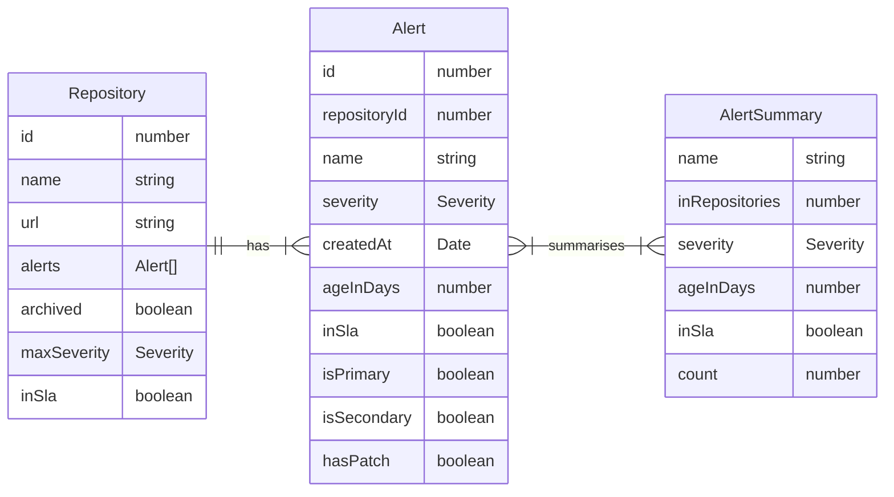

# Dependabot Alerts vs SLAs

Create your key here: https://github.com/settings/personal-access-tokens

TODO: Work out minimum permissions needed



```js
// Initial Data
const dependabotAlertsVsSla = await FileAttachment(
  "./data/github/dependabot-alerts-vs-sla.json"
).json();
const { repositories, alertSummaries } = dependabotAlertsVsSla;
```

```js
// Shared code
const flattenSeverity = (severity) => `${severity.value}-${severity.label}`;
const flattenAlertSeverity = (alert) => ({
    ...alert,
    severity: alert.severity && flattenSeverity(alert.severity)
});
const formatFlatSeverity = (severity) => severity.replace(/\d+\-/, "");
const formatDays = (days) => `${days} Days`;
const formatBoolean = (bool) => bool ? '\u2714' : '\u26A0';
const formatLink = ([name, link]) => {
    const element = document.createElement('a');
    element.href = link;
    element.text = name;
    return element;
}
```

## Alert Summaries:

```js
const alertName = view(Inputs.text({label: "Alert Name", placeholder: "Filter by name"}));
```

```js
const alertSummariesTableData = alertSummaries
    .filter(alert => (
        alert.name.toLocaleLowerCase().includes(alertName.toString().toLocaleLowerCase())
    ))
    .map(flattenAlertSeverity);

const selectedAlertSummaries = view(Inputs.table(alertSummariesTableData, {
    sort: "severity",
    columns: ["name", "severity", "ageInDays", "inSla"],
    header: {
        name: "Name",
        severity: "Severity",
        ageInDays: "Age",
        inSla: "Is in SLA",
    },
    format: {
        severity: formatFlatSeverity,
        ageInDays: formatDays,
        inSla: formatBoolean,
    }
}));
```

## Repositories:

```js
const repoName = view(Inputs.text({label: "Repository Name", placeholder: "Filter by name"}));
// TODO: Add ignore summaries toggle
```

```js
const selectedAlertNames = selectedAlertSummaries.map((alert) => alert.name);

const repoTableData = repositories
    .filter((repo) => repo.alerts.some((alert) => selectedAlertNames.includes(alert.name)))
    .filter((repo) => repo.name.toLocaleLowerCase().includes(repoName.toString().toLocaleLowerCase()))
    .map((repo) => ({
        ...repo,
        maxSeverity: repo.maxSeverity && flattenSeverity(repo.maxSeverity)
    }));

let selectedRepos = view(Inputs.table(repoTableData, {
    sort: "name",
    columns: ["name", "maxSeverity", "inSla"],
    header: {
        name: "Name",
        maxSeverity: "Most Severe Alert",
        inSla: "Is in SLA",
    },
    format: {
        maxSeverity: formatFlatSeverity,
        inSla: formatBoolean,
    }
}));
```

## Alerts for Selected Repos:

```js
const selectedRepoNames = selectedRepos.map((repo) => repo.name);

// Flatten the alerts
const flattenedAlerts = selectedRepos
    .filter((repo) => selectedRepoNames.includes(repo.name))
    .flatMap((repo) => 
        repo.alerts.map((alert) => ({
            repoName: repo.name,
            alertName: alert.name,
            severity: flattenSeverity(alert.severity),
            ageInDays: alert.ageInDays,
            inSla: alert.inSla,
            relationship: alert.relationship,
            hasPatch: alert.hasPatch
        }))
    );

view(Inputs.table(flattenedAlerts, {
    sort: "severity",
    header: {
        repoName: "Repository",
        alertName: "Alert",
        severity: "Severity",
        ageInDays: "Age",
        inSla: "Is in SLA",
        relationship: "Relationship",
        hasPatch: "hasPatch",
    },
    format: {
        severity: formatFlatSeverity,
        inSla: formatBoolean,
        hasPatch: formatBoolean,
    }
}));
```
